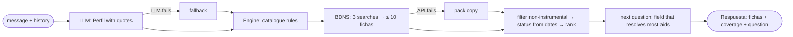

# Architecture

**RFC**: [RFC.md](RFC.md)

## Components

| Component | Job | State | Spec |
|---|---|---|---|
| Chat UI | Sends the message and history; renders cards, coverage and the optional question | browser memory only | S1 |
| `/api/chat` | Entry point: validates input, runs the LLM loop, returns `Respuesta` | none | S3 (mock in S0) |
| LLM loop | One LLM call per message → `Perfil` with literal quotes; picks the next question; applies guardrails | none | S3 |
| Engine | `Perfil` → `Ficha[]` + coverage: catalogue rules, BDNS search, filter, status, ranking | short in-memory cache of public BDNS fichas | S2 |
| BDNS adapter | 3 searches + ≤ 10 ficha calls, parallel, timeout; normalises API and pack to one shape | none | S2 |
| Benefits catalogue | `datos/catalogo-tramites-ayudas.json`, 8 aids, used unchanged | versioned | — |
| Pack BDNS copy | `datos/bdns-convocatorias-cv.json`, fallback if the API fails | versioned | — |
| Central aid store *(optional)* | `src/datos/central.json`, aids outside BDNS in the catalogue's shape; `src/datos/textos/` holds read texts by hash | versioned, rebuilt daily by `bun run indexar` in GitHub Actions | S4 |
| HelmCode LLM | `glm5.3-flash` via `src/lib/ia.ts` (`completar`) | external | — |
| BDNS API | Live calls, public, no key, no CORS | external | — |

No citizen text is stored. Only public BDNS data is cached in server memory while the process runs.

## One run



## Contracts

Defined in S0, in `src/lib/tipos.ts`. Field names are fixed by S0; this is the shape.

| Type | Holds |
|---|---|
| `Perfil` | Facts about the citizen, each with the literal quote it comes from; the stated need; unknown fields left empty |
| `Ficha` | Title, purpose, source (catalogue / BDNS / central store), status (open / closed / permanent / unknown), official link, why it fits, requirements to check, `verificado` |
| `Respuesta` | `Ficha[]`, coverage (what was checked and what was not), optional next question |

| Function / route | Purpose | Owner |
|---|---|---|
| `POST /api/chat` `{ mensajes } → Respuesta` | The only route the UI calls | S3 (mock in S0) |
| `buscarAyudas(perfil): Promise<{ fichas, cobertura }>` | The engine; the only thing S3 calls from S2 | S2 |
| `completar(messages)` | Existing HelmCode call with 429 retry | existing |

## Hosting

Next.js 16 on Vercel, built with bun; all external calls run on the server.

| Piece | Used for |
|---|---|
| Vercel | Hosting the app and `/api/chat` |
| Env vars `HELMCODE_*` | LLM key and model, never in code |
| HelmCode | LLM; limits 100 RPM and 10 concurrent per key, shared by all teams |
| BDNS API | ≤ 1 request per second advised; search has no dates, so each result needs its ficha |

## Repo layout

Goal: each spec owns its own folders, so four people never edit the same file.

```
src/lib/tipos.ts        contracts                             S0
src/datos/ejemplos/     fixtures, 4 test profiles             S0
src/app/page.tsx        chat page                             S1
src/components/         UI components                         S1
src/lib/motor/          catalogue rules, filter, rank         S2
src/lib/bdns.ts         BDNS adapter + pack fallback          S2
src/app/api/chat/       route                                 S3
src/lib/llm/            prompts, profile parsing, guardrails  S3
src/datos/              central aid store, seeds, read texts  S4
scripts/indexar/        crawl, extract, dedup, write store    S4
.github/workflows/      daily indexing job                    S4
datos/                  pack files, read-only
```

| Layer | May import | May not import |
|---|---|---|
| `tipos.ts` | nothing | everything else |
| `components/`, `page.tsx` | `tipos` | `motor`, `llm`, `bdns` (talks to `/api/chat` only) |
| `motor/`, `bdns.ts` | `tipos`, `datos/` | `llm`, UI |
| `llm/`, `api/chat/` | `tipos`, `motor` (via `buscarAyudas`), `ia.ts` | UI, `bdns.ts` directly |

## Scaling to more sources

A new aid source is one adapter in `src/lib/motor/` that returns `Ficha[]`; S4 (`central.ts`) is the first example.
S4 indexes offline: a daily job crawls seed pages, makes one LLM call per new or changed page (≤ 30 per run), checks quotes by code, and commits `central.json`; at query time the engine only reads it in memory.
S4 keeps only aids that no API gives (no BDNS calls), so it never overlaps S2.
Limits that appear first: BDNS ficha calls (1 per result) and the shared LLM rate limit.
Embeddings and pgvector are not built until measured: past a few thousand aids, or when keyword match misses aids; the texts saved by hash let us build them without crawling again.
A candidate next source, not built: third-sector resources (NGO programmes for school support and families), listed in `docs/backlog/third-sector-resources.md`; it needs its own shape and label, since these are services of private entities, not public aids.

## Decisions

| Decision | Why | Beat |
|---|---|---|
| Chat, no form; one optional question per turn | User decision | Form with fixed fields |
| One LLM call per message | Cost, latency, shared rate limit | Second call for ranking |
| An aid stays while no stated fact blocks it | Unknown never blocks; ask the most filtering field first | Drop aids on missing data |
| Status from ficha dates, never from `abierto` | `abierto` only means "no end date" | Trust `abierto` |
| Catalogue rules in the engine (S2) | Deterministic and testable without the LLM | Rules in the LLM loop |
| Contracts and mock first (S0) | UI and LLM work start without waiting for the engine | Build in sequence |
| Pack copy as BDNS fallback, and the UI says so | Demo must work without network | Fail the request |

## Security

- The HelmCode key lives only in server env vars; the browser never sees it.
- No citizen text is logged or stored; fixtures use the 4 fictitious test profiles.
- Do not use the GVA dataset `eco-gvo-subv-2026` (contains beneficiaries' personal data).
- Cite "Origen de los datos: Intervención General de la Administración del Estado" with the query date.
