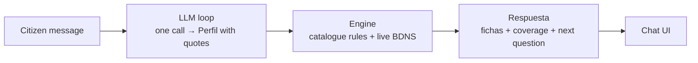
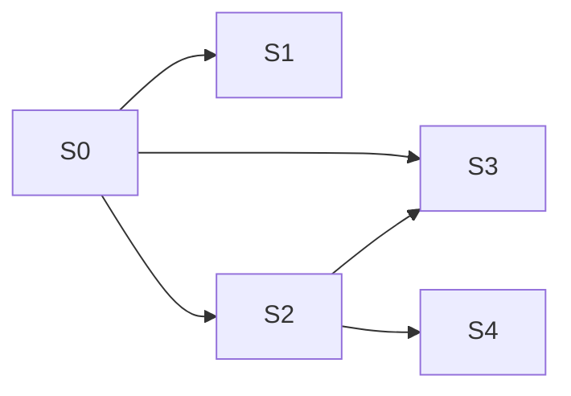

# RFC: Derechos · akorda — aid finder chat

**Status**: Draft · **Date**: 2026-10-22 · **Design**: [ARCHITECTURE.md](ARCHITECTURE.md)

## Summary

A chat where a citizen describes their situation in their own words and learns which public aids (State, Comunitat Valenciana, València) they could apply for: why, what to check, status and official link.
The first release is the Build night demo: one LLM call reads the message into a quoted profile, a deterministic engine matches it against the 8 catalogue aids and the live BDNS, and the chat shows cards and a coverage panel.
Work is split into four parallel specs over shared contracts (S0); centralising unstructured aids (S4) comes only if time allows.

## Problem

- Public aids are spread across the State, the region and the city; nobody tells a citizen which ones they could apply for.
- The BDNS lists calls, not eligibility: `abierto` does not mean open today, 14 of 59 pack calls are instrumental, 17 of 27 dated ones expire by 22 Oct.
- An LLM alone invents aids and requirements; the tool must invent nothing and say what it could not check.

## Goals and non-goals

| Goals | Non-goals |
|---|---|
| Chat answer with aid cards: reason, requirements to check, status from dates, official link | Form or button-driven flow |
| Every claim about the citizen quotes their words; "you could apply", never "you are entitled" | Storing citizen text |
| Coverage panel: what was checked and what was not (e.g. no municipal data outside València) | DANA aids (link to sede.gva.es instead) |
| Works offline from the pack copy if the BDNS fails | Postgres / pgvector, embeddings + rerank, PDF indexing |
| Four people build in parallel without blocking each other | Dynamic vocabulary + cron, catalogue pipeline with human validation, all of Spain (later, not this project) |

## Proposal

Details, contracts and decisions: [ARCHITECTURE.md](ARCHITECTURE.md).

## Alternatives considered

| Option | Rejected because |
|---|---|
| Form with fixed fields | User decision: chat from the start; the chat may ask one optional question instead |
| LLM picks the aids directly | Invents aids; rules + BDNS are checkable and testable without the LLM |
| Second LLM call for ranking | Cost and latency; ranking by need-to-purpose mapping + title keywords is enough for the demo |
| Index + pgvector now (old v3) | Too much for the build; out of scope until after the event |

## Specs

Each row becomes one mini-spec in `specs/` (`/mini-spec`).

| ID | Name | Delivers | Depends on |
|---|---|---|---|
| S0 | Contracts | Types `Perfil`, `Ficha`, `Respuesta`; fixtures for the 4 test profiles; mock `/api/chat` returning them | none |
| S1 | Chat UI | Chat, aid cards, coverage panel, optional question; loading, error and "unconfirmed" states; built against the mock, switched to the real route at the end | S0 |
| S2 | Engine / API | `Perfil` → fichas + coverage: rules for the 8 catalogue aids, 3 BDNS searches, non-instrumental filter, ≤ 10 fichas, status from dates, ranking; parallel calls, timeout, short cache; pack fallback | S0 |
| S3 | LLM loop | Real `/api/chat`: message + history → one LLM call → `Perfil` with quotes → S2 → `Respuesta` with the most filtering question; guardrails; fallback if the LLM fails | S0, S2 (as a function) |
| S4 | Centralise aids *(optional)* | Unstructured aids and benefits normalised to `Ficha` in `src/datos/` by `bun run indexar`; S2 reads them as one more source | S0, S2 |

- **S0 to S3** is the first release: the demo, end to end, with the 4 test profiles.
- **S4** only adds reach (more aid sources); S1 and S3 do not change.
- S1, S2 and S3 run in parallel after S0. S3 codes against the S2 function signature from S0 until S2 lands.

## S0 checklist

S0 is code, not a checklist; these are the hand-made items it needs.

| Item | Needed by | Owner |
|---|---|---|
| `HELMCODE_API_KEY` and `HELMCODE_MODEL` in `.env.local` and Vercel, set from your own terminal, never in chat | S3 | team |
| Vercel project linked to the repo | S1–S3 | team |
| Owner per spec | S0–S4 | Julia (captain) |

## Open questions

**Resolved**

| Question | Answer |
|---|---|
| Version split v1 / v2 / v3 (page, 2026-10-21) | Replaced by the S0–S4 split; v3 out of the project (chat, 2026-10-22) |
| Where do the catalogue rules live? | S2, the engine; S3 stays conversation → profile → answer (chat, 2026-10-22) |
| Prepare the contracts today? | Yes, S0 first (chat, 2026-10-22) |

**Open**

| # | Question | Blocks | Owner |
|---|---|---|---|
| 1 | Who owns S0, S1, S2, S3? (S1: the non-technical member) | S0–S3 | Julia |
| 2 | Approve the proposed guardrail set (page, Guardrails tab) | S3 | team |
| 3 | Version `docs/` (in `.gitignore` today) or share the page another way? | none | team |
| 4 | LLM fallback: BM25 on `frases_usuario`, or a plain "try again" message? | S3 | S3 owner |
| 5 | Does S4 cover only `datos/` plus named benefit sources, or which sources exactly? | S4 | team |

**Decision (2026-10-22):** Work split S0–S4 with catalogue rules in S2 and S0 first. Revisit if S0 is not done before the others start.
